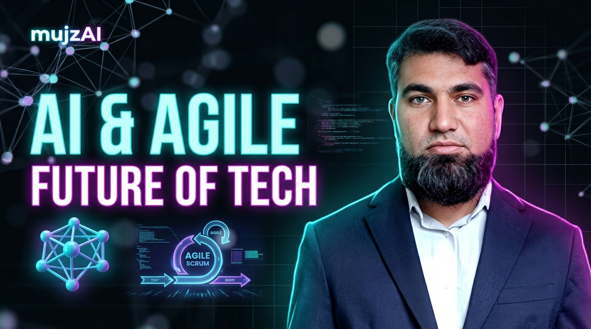

  

# Hi, I'm Mujeeb Mohammed 👋

**Agile Delivery & Transformation Leader  •  Builder of Production Agentic AI Delivery Applications**

---

### About Me

I bridge **Enterprise Agile Delivery & Transformation leadership** with **hands-on Agentic AI engineering**—designing, building, and shipping production AI applications that solve real delivery, product, and platform engineering challenges.

---

### 🚀 Featured Production Launch: [AI Role Agents](https://github.com)

An enterprise multi-agent advisory platform featuring **12 domain-specialist AI personas**, production hybrid RAG (Qdrant Cloud & Hugging Face), glass-box FastAPI/WebSocket telemetry, and a live demo at **[ai-role-agents.vercel.app](https://vercel.app)**.

---

### 🔭 What's Next — More Agentic AI Delivery Apps in the Works!

Besides **AI Role Agents**, I am actively architecting and building **several new Agentic AI Delivery applications** focused on automating programme governance, intelligent delivery forecasting, and multi-agent engineering workflows.

👉 **Follow my GitHub profile** and subscribe on **[YouTube (@mujzAgenticAIDelivery)](https://youtube.com)** to stay tuned for upcoming releases and end-to-end architectural walkthroughs!

---
